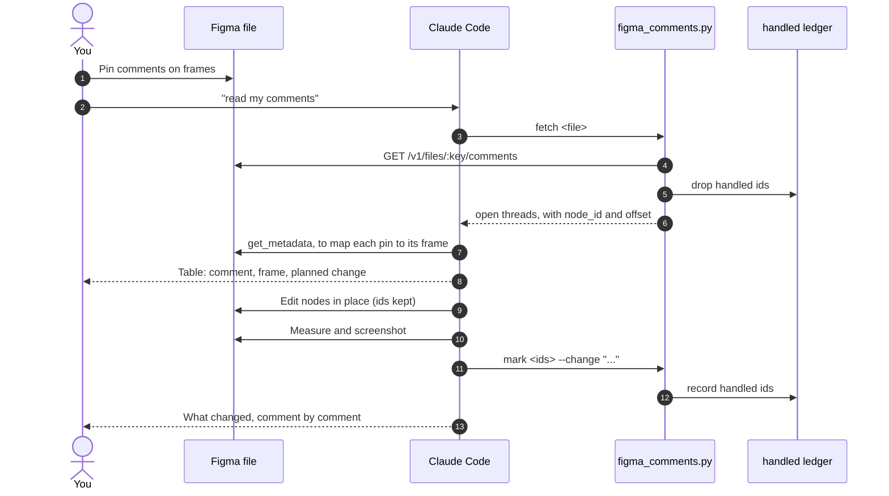

# figma-build-skill

A Claude Code skill and two small tools for building in Figma with code, and for running design review through Figma comments.

Most failures in Figma automation are silent. A text node collapses to 10 px, an auto-layout column shrinks to a sliver, a build aborts halfway, a frame lands on top of existing work. Figma accepts the call and draws the wrong thing. This skill gives Claude the rules that avoid those failures. Its tools read review comments, which the Figma MCP cannot do.

- **The skill** (`SKILL.md`) holds the rules Claude follows when it writes Figma code.
- **`tools/figma_comments.py`** reads comment threads, keeps a ledger of handled feedback and replies in threads. It has no delete command.
- **`tools/figma_stub.js`** is a strict local stub of the Plugin API, for running plugin code before it reaches Figma.

## Contents

- [How it works](#how-it-works)
- [The review loop](#the-review-loop)
- [Components](#components)
- [Requirements](#requirements)
- [Setup](#setup)
- [Daily use](#daily-use)
- [Repository layout](#repository-layout)
- [Design decisions and limits](#design-decisions-and-limits)
- [Security](#security)
- [Troubleshooting](#troubleshooting)

## How it works

Claude Code loads the skill when a task involves building or fixing something in Figma. Claude reaches Figma through two channels, plus an optional third:

| Channel | Used for | Why |
|---|---|---|
| **Figma MCP** (`use_figma`, `get_metadata`, `get_screenshot`) | Building and editing frames, reading geometry, screenshots | The standard way for Claude to run code in your open file |
| **Figma REST API** with your token (`tools/figma_comments.py`) | Reading comment threads, replying | Neither the MCP nor the Plugin API can read comments |
| **Your own development plugin** (optional) | Builds too large for one MCP call | It runs the same Plugin API code, started by you from Figma |

The skill covers what both code routes get wrong: the order of text properties, auto-layout sizing axes, circular constraints, clamping values, font loading, drawing position, build stamps and verifying by geometry.

## The review loop



1. **Comment.** Pin each comment on the frame it's about. Instructions in thread replies are read too.
2. **Fetch.** The tool returns open threads, with replies in order. It leaves out resolved threads and everything already in the ledger.
3. **Map and confirm.** Claude matches each pin to its frame, using the file's geometry. Before drawing anything, it shows a table of comment, frame and planned change. An ambiguous comment gets a question, not a guess.
4. **Edit in place.** Claude changes properties on the existing nodes and keeps their ids. Comments are pinned to node ids, so redrawing a frame would orphan them.
5. **Verify.** Claude checks the result by geometry and a screenshot.
6. **Record.** Every handled comment id goes to the ledger, so the next review, or the next conversation, doesn't apply it again.
7. **Report.** Claude summarises comment by comment. With the write scope, it can also reply in each thread.

Comments are never deleted. They are your review record, and resolving them stays with you.

## Components

| Component | File | Role |
|---|---|---|
| Rules | `SKILL.md` | What Claude follows when writing Figma code, plus the review loop |
| Comments client | `tools/figma_comments.py` | `check`, `fetch`, `mark`, `reply`, `selftest`. Keeps the ledger. No delete command |
| Plugin API stub | `tools/figma_stub.js` | Throws where Figma throws: negative sizes, unloaded fonts, null children. Seeds existing frames. Approximates auto-layout heights |
| Stub test | `tools/test_figma_stub.js` | Proves the stub is still strict |
| Ledger | `figma-comments-handled.json`, in your work folder | Comment ids already handled, with what changed |

## Requirements

- [Claude Code](https://claude.com/claude-code)
- The Figma connector in Claude (claude.ai → Settings → Connectors → Figma), with edit access to the file
- For comments: Python 3 (standard library only) and a Figma personal access token with **File comments: Read**. Add **File comments: Write** only if you want replies in threads.
- For the stub: Node.js
- For a development plugin: the Figma desktop app

## Setup

```bash
git clone https://github.com/ABarracu87/figma-build-skill ~/.claude/skills/figma-build
```

1. **Token.** Figma → Settings → Security → Personal access tokens. Save it as one line in `~/.figma-token`, then run `chmod 600 ~/.figma-token`.
2. **Check the token:**
   ```bash
   python3 ~/.claude/skills/figma-build/tools/figma_comments.py check <figma-file-url>
   ```
   It should print `OK: token reads comments (N on file KEY)`.
3. **Check the tools:**
   ```bash
   python3 ~/.claude/skills/figma-build/tools/figma_comments.py selftest   # selftest PASS
   node ~/.claude/skills/figma-build/tools/test_figma_stub.js               # stub test PASS
   ```
4. **Restart Claude Code.**

## Daily use

| You say | What happens |
|---|---|
| "Build the wireframes for this page in Figma: <file>" | A first build, below any existing work, with a build stamp |
| "Read my comments" | The review loop above |
| "Why does this frame look collapsed?" | Claude measures the geometry and names the rule that was broken |
| "Test this plugin locally" | The plugin runs against the strict stub before you import it |

By hand:

```bash
T=~/.claude/skills/figma-build/tools/figma_comments.py
python3 $T fetch <file-url>                 # open threads as JSON
python3 $T fetch <file-url> --all           # everything, resolved and handled included
python3 $T mark  <file-url> 123 124 --change "Logo 20% bigger on the story format"
python3 $T reply <file-url> 123 "Done: logo is now 20% bigger"
```

Run it from your work folder so the ledger lands there, or set `FIGMA_LEDGER=/path/to/ledger.json`.

## Repository layout

```
SKILL.md                    rules for Figma code and the review loop
tools/
  figma_comments.py         comments client: check, fetch, mark, reply, selftest
  figma_stub.js             strict Plugin API stub
  test_figma_stub.js        stub test
LICENSE
```

## Design decisions and limits

- **A skill, not a server.** The rules are plain text. Until a Figma task triggers it, only the skill's description sits in Claude's context. To fix a rule, edit `SKILL.md`.
- **Edit in place during review.** Clear-and-rebuild suits first builds only. Once comments exist, redrawing a frame orphans them.
- **A ledger, not deletion.** Figma's API has no endpoint for resolving comments, and its delete endpoint only works on your own comments. The ledger keeps old feedback out of later rounds without touching the review record.
- **Mapping by geometry.** A comment's `node_offset` is matched to the child frame whose area contains it. A comment pinned on empty canvas can't be matched, so Claude asks.
- **The stub has no text metrics.** It proves the code runs without throwing, not that the layout is right. The geometry checks in `SKILL.md` cover layout.
- **The plugin route needs a click per run.** Development plugins can't be started from outside Figma.
- **Comments belong to a file.** Moving work to a new file leaves its comments behind.

## Security

- The token is read from `~/.figma-token` (or `$FIGMA_TOKEN_FILE`). It is never printed, and never put on a command line or in a URL.
- The token only needs comment scopes. File content access isn't required.
- The ledger holds comment ids and short change notes, not comment text. Keep it out of public repos anyway, because it contains your file key.

## Troubleshooting

| Symptom | Cause and fix |
|---|---|
| `no token at ~/.figma-token` | Save the token as one line in that file |
| `HTTP 403` on `check` | The token lacks **File comments: Read**, or your account can't open the file |
| `HTTP 403` on `reply` | Replying needs **File comments: Write** |
| `SSL certificate check failed` | This Python has no root certificates. Use `/usr/bin/python3`, run `Install Certificates.command` from your Python folder, or `pip install certifi` |
| `/v1/me` returns 403 | Expected with a comments-only token. The token is fine |
| Old feedback applied again | Run from the folder that holds the ledger, or set `FIGMA_LEDGER` |
| Text 10 px tall, frames collapsed | Text properties set in the wrong order. See *Text sizing* in `SKILL.md` |
| Copy wrapping one letter per line | A circular auto-layout constraint. See *A column that fills a row* |
| Plugin toast shows an old build stamp, or "replaced 0" with frames visible | Figma is running a cached plugin. Remove it, import `manifest.json` again and reopen the tab. If that fails, change the manifest `id` |
| A comment no longer points at its frame | The frame was redrawn instead of edited in place. Review edits must keep node ids |

## License

[MIT](LICENSE)
