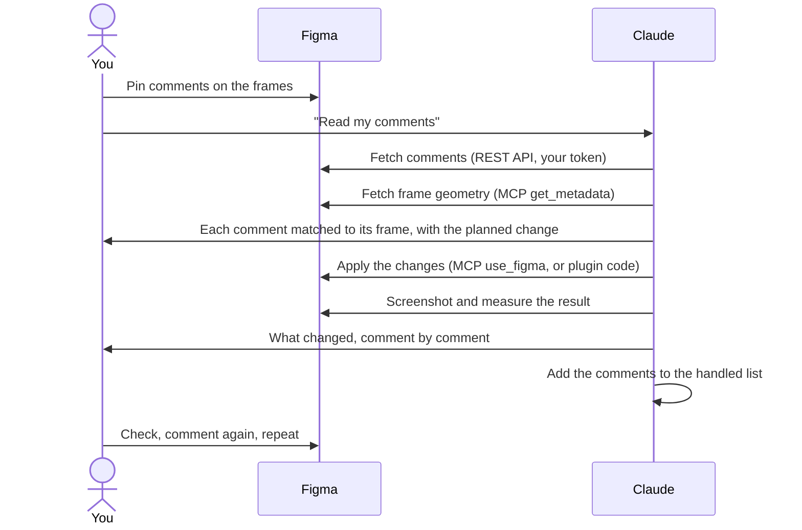

# figma-build-skill

## Catch the Figma mistakes that never throw an error.

When Claude builds in Figma, most failures are silent. Text collapses to 10 px, cards shrink to a sliver, frames land on top of your work, and nothing warns you. This skill teaches Claude those failures before it writes the first line, so you review designs, not broken canvases.

```bash
git clone https://github.com/ABarracu87/figma-build-skill ~/.claude/skills/figma-build
```

Free and open source (MIT). It works with [Claude Code](https://claude.com/claude-code) and the official Figma MCP.

---

## What it fixes

| What you see | What actually went wrong | What the skill makes Claude do |
|---|---|---|
| Text boxes about 10 px tall, and the frames around them collapsed | Figma only re-measures text when its content changes | Set text properties in the one order that works |
| Cards about 45 px wide, copy wrapping one letter per line | A circular auto-layout constraint, resolved at the minimum | Give rows explicit widths instead of relying on stretch |
| A row that won't grow, however wide you set it | On horizontal frames the fixed width lands on the wrong axis | Pick the sizing axis by frame direction |
| A half-drawn page that looks like a layout bug | One negative width or unloaded font aborted the whole build | Clamp every size, and resolve fonts through a fallback chain |
| New frames stacked on top of existing work | The build started at (0, 0) | Measure the page and start below what's there |
| "It looks the same" after a change | A cached bundle, or a run that never happened | Stamp every build and count what it replaced |
| Your Figma comments ignored | No MCP tool and no plugin API reads comments | Read them through Figma's REST API and map each one to its frame |
| Dozens of screenshot calls | One capture per block | One capture per page, cropped locally |

## Why you want it on top of the Figma MCP

**The MCP gives Claude hands.** It reads your file and runs code in it. When that code is subtly wrong, Figma usually accepts it and draws the wrong thing. There's no error, so Claude has nothing to learn from, and it rediscovers the same mistakes in every new session.

**The skill gives Claude the experience.** It's a plain-text list of every failure above and what to do instead. Claude reads it the moment a Figma task starts.

- **It stays out of the way.** Until a Figma task triggers it, only its one-line description sits in Claude's context.
- **You can extend it.** Hit a new silent failure? Add it to `SKILL.md`, and Claude won't repeat it.

## Setup

1. **Install the skill:** `git clone https://github.com/ABarracu87/figma-build-skill ~/.claude/skills/figma-build`
2. **Connect Figma** in Claude: claude.ai → Settings → Connectors → Figma. Your own Figma plugin works too.
3. **Optionally, let Claude read your comments.** Create a Figma personal access token with the **File comments: Read** scope. Add **File comments: Write** only if you want Claude to reply in threads. Save it to `~/.figma-token` (`chmod 600`), and never paste it into a chat.
4. **Restart Claude Code.** The skill loads itself whenever you ask Claude to build or fix something in Figma.

## The review loop: comment in Figma, Claude updates the design

You review in Figma the way you would with a designer. You leave comments on the canvas, and Claude reads them and changes the design.



**1. You comment.** Pin each comment on the frame it's about, not on empty canvas. Claude uses the pin's position to find the frame. Replies in a thread are read too, and the instruction is often in the reply.

**2. You ask.** Say *"read my comments"* in Claude Code, with the file link if Claude doesn't have it yet.

**3. Claude reads and matches.**
- It fetches the comments from Figma's REST API with your token. No MCP tool can read comments.
- It groups the replies into their threads.
- It matches each pin to the frame underneath, using the file's geometry.
- It tells you which comment it will apply to which frame, so a misread shows up before anything is drawn.

**4. Claude updates the design.** It edits the frames in place, or rebuilds and replaces its own frames, so you never end up with duplicates. Then it screenshots and measures the result. It reports back comment by comment. With the **File comments: Write** scope on your token, Claude can also reply in each thread.

**5. Claude closes the round.** Old comments stay in the file, so a later review, or a later conversation, would read them again and re-apply old feedback. To prevent that, Claude adds every comment it acted on to `figma-comments-handled.json` next to the work, and skips those from then on. It skips resolved comments too.

**Claude never deletes comments.** They're your review record. Resolve them in Figma whenever you like.

**6. You check, and comment again.** Repeat until it's approved.

Comments belong to a file. If the work moves to a new file, the old comments stay behind, so finish or copy them over first.

### Do I need to re-import anything?

That depends on how Claude edits your file.

| Route | What you do after each change | When you re-import |
|---|---|---|
| **Figma MCP** (`use_figma`), the default | Nothing. Claude runs the code in your open file, and the canvas updates. | Never. |
| **Your own development plugin** (for builds too big for one MCP call) | Run the plugin again: Plugins → Development → *your plugin*. Claude edits the plugin's code on your machine, and Figma runs whatever is on disk. | When the closing message shows an **old build stamp**, or reports **"replaced 0"** while frames are visible. That means Figma is running a cached copy. Remove the plugin, import it again from its `manifest.json` (Plugins → Development → Import plugin from manifest), then reopen the file tab. If that still doesn't help, Claude changes the plugin's `id` in the manifest to force a clean load. |

On the plugin route, every run ends with a message such as `Build 15:03 — replaced 12 frames`. Check the stamp first. If the time doesn't match the build Claude just made, you're looking at the old version, whatever the canvas shows.

Development plugins need the Figma desktop app.

## What's inside

- The verification loop: a build stamp, clearing your own output, and counting replaced frames
- Clamping the values that would abort a build
- Never drawing on top of existing work
- Text sizing, in the only order that works
- Auto-layout sizing axes, and the column that fills a row
- Measuring geometry instead of eyeballing screenshots
- A strict local stub of the `figma` global, for testing plugin code before the round trip
- Font loading and per-family style names
- One plugin, one job, and forcing a clean reload
- Reading Figma comments through the REST API
- Screenshots at scale

## Frequently asked questions

**Does it replace the Figma MCP?**
No. The MCP is how Claude reaches your file, and the skill is how it avoids the mistakes. Use both.

**Does it work with my own Figma plugin?**
Yes. The rules are about the Figma Plugin API itself. They apply whether the code runs through the MCP or through your plugin.

**Does it need a Figma token?**
Only for reading comments. Everything else works through the Figma connector.

**Can I change it?**
Yes. It's one markdown file. Edit it, and Claude follows your version.

## Need whole ad campaigns, not just builds?

[ai-campaign-kit](https://github.com/ABarracu87/ai-campaign-kit) uses this skill to turn one brief into every static format, every language and a motion version, in your brand's voice.

---

MIT licence.
